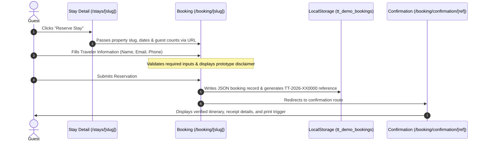

# TRUST.TRAVEL Booking Engine & Search Architecture

## 1. Overview

TRUST.TRAVEL implements an end-to-end, prototype-safe travel search, property exploration, and demonstration checkout flow. The flow allows users to:
1. Search properties by destination, dates, and guest headcount.
2. Refine results via multi-parameter facet filters and price sorting.
3. Review detailed property specifics, photo galleries, amenities, and host cancellation rules.
4. Complete an interactive demonstration reservation with deterministic pricing breakdowns, instant reference code generation, and confirmation receipts.

> [!IMPORTANT]
> This is a high-fidelity demonstration prototype. **No real payment transactions are processed**, and **no real hotel reservations are booked**. All reservation payloads are stored exclusively in the user's browser `localStorage`.

---

## 2. Search & Filter Engine (`src/lib/search-utils.ts`)

The search engine acts as a pure, deterministic filtering pipeline operating over `src/data/properties.ts`.

### 2.1 URL Query Parameters
Search inputs translate into standardized URL query parameters:

| Parameter | Type | Example | Description |
| :--- | :--- | :--- | :--- |
| `destination` | `string` | `scotland` | Matches destination slug or city/country name. |
| `checkIn` | `string` (ISO) | `2026-06-23` | Reservation arrival date. |
| `checkOut` | `string` (ISO) | `2026-06-29` | Reservation departure date. |
| `guests` | `number` | `2` | Filters properties with `capacity.guests >= guests`. |
| `rooms` | `number` | `1` | Filters properties with `capacity.bedrooms >= rooms`. |
| `type` | `string` | `hotels` | Filters by category (`hotels`, `villas`, `apartments`, etc.). |
| `minPrice` | `number` | `200` | Minimum nightly rate in USD. |
| `maxPrice` | `number` | `800` | Maximum nightly rate in USD. |
| `sort` | `string` | `price-asc` | Sorting mode: `featured`, `price-asc`, `price-desc`, `rating`. |

### 2.2 Date Calculation Rules (`src/lib/date-utils.ts`)
1. **Departure Sequence**: Check-out must occur at least 1 calendar day after check-in. If an invalid or inverted date range is entered, the calculation safely defaults to a 1-night minimum stay.
2. **Night Calculation**:
   ```typescript
   export function calculateNights(checkIn: string, checkOut: string): number {
     const t1 = new Date(checkIn).getTime();
     const t2 = new Date(checkOut).getTime();
     const diffDays = Math.round((t2 - t1) / (1000 * 60 * 60 * 24));
     return diffDays > 0 ? diffDays : 1;
   }
   ```
3. **Deterministic Demo Dates**: The system defaults to standard demo dates (`2026-06-23` to `2026-06-29`, exactly 6 nights) matching the reference design to ensure prerender determinism.

---

## 3. Financial Calculation Model (`src/lib/booking-utils.ts`)

Pricing is calculated consistently across property detail panels, checkout summaries, and confirmation invoices:

$$\text{Base Total} = \text{Price Per Night} \times \text{Nights}$$
$$\text{Cleaning Fee} = \text{round}(0.25 \times \text{Price Per Night})$$
$$\text{Service Fee} = \text{round}(0.10 \times \text{Base Total})$$
$$\text{Local Tourism Taxes} = \text{round}(0.08 \times \text{Base Total})$$
$$\textbf{Total Reservation Cost} = \text{Base Total} + \text{Cleaning Fee} + \text{Service Fee} + \text{Taxes}$$

### Multi-Currency Conversion (`src/lib/currency.ts`)
Pricing is natively stored in USD and dynamically converted for display when the user toggles the currency selector in the navigation bar:
- **USD**: Baseline currency (`$`)
- **EUR**: Rate 0.92 (`€`)
- **GBP**: Rate 0.78 (`£`)
- **JPY**: Rate 155.0 (`¥`)

---

## 4. Demo Reservation Workflow



### 4.1 Demo Reference Format
References follow the format `TT-2026-XX####`:
- Prefix `TT-2026-`
- 2 randomized uppercase alphanumeric characters
- 4 randomized digits
- Example: `TT-2026-AK4821`

---

## 5. Production Integration Blueprint

To upgrade this prototype into an active commercial production system:

### 5.1 Payment Processing (Stripe Integration)
1. Replace the local submit handler in `src/app/booking/[slug]/page.tsx` with a server action calling `stripe.checkout.sessions.create()`.
2. Collect line items derived from `calculateBookingPrice()`.
3. Handle the Stripe webhook (`checkout.session.completed`) to persist the confirmed booking into your database (PostgreSQL / Supabase / Prisma).

### 5.2 Property Management System (PMS) Synchronization
1. Synchronize property availability using iCal feeds or PMS REST APIs (e.g., Guesty, Mews, Cloudbeds).
2. Query live availability during date selection to disable booked calendar dates.

### 5.3 Automated Guest Communication
1. Send transactional confirmation emails via Resend, SendGrid, or AWS SES using React Email templates.
2. Deliver SMS arrival instructions via Twilio 24 hours prior to check-in.
